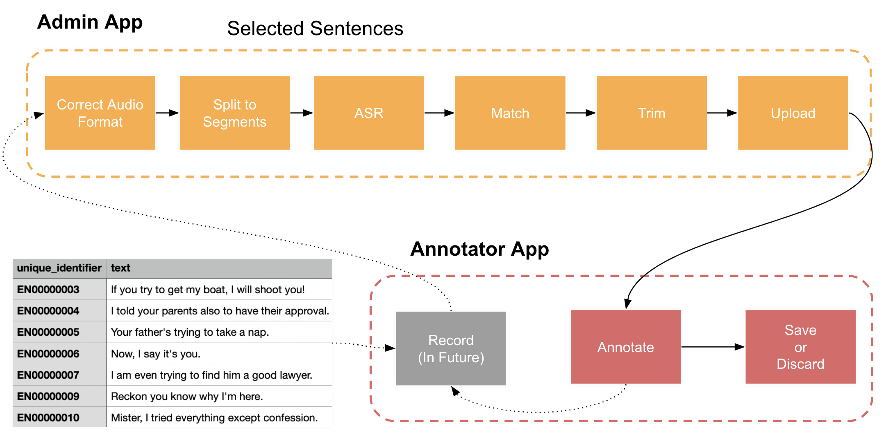

# TTS QA - أداة تقييم جودة بيانات التعليق التوضيحي لتحويل النص إلى كلام


<!--  add video link  https://www.youtube.com/watch?v=TH71pxxMFfE-->


## **نظرة عامة**
<!-- insert a image  resources/tts-workflow.png-->
<!-- put image here -->



للحصول على نظرة عامة سريعة عن المشروع، يُرجى مشاهدة الفيديو التالي:
[](https://www.youtube.com/watch?v=TH71pxxMFfE)


## **الخطوة 1: المتطلبات الأساسية**

- Python 3.6 أو أعلى مثبّت على نظامك مع الحزم المذكورة في requirements.txt. يمكنك تثبيتها باستخدام pip install -r requirements.txt أثناء تفعيل البيئة.
- docker-compose
- حزمة aiXplain SDK مثبّتة ومُهيّأة كما هو موضّح في **[وثائق aiXplain SDK](https://github.com/aixplain/aiXplain#getting-started)** (مزيد من التفاصيل أدناه)
- بيانات اعتماد AWS S3 (مفتاح الوصول ومفتاح الوصول السري) لرفع وتنزيل الملفات من S3

#### التفاصيل:
قبل تشغيل الكود، ستحتاج إلى إعداد الخدمات التالية لتهيئة المستودع:
- **[aiXplain](https://platform.aixplain.com/)**: لنسخ الصوت نصيًا، يتم الوصول إلى نماذج ASR من منصة aiXplain. يستخدم هذا المستودع منصة aiXplain ونماذجها كعنصر أساسي. توفّر aiXplain حلول AI/ML سهلة الاستخدام بدون كود لتكاملها في التطبيقات مثل هذا التطبيق. يمكن تكاملها بسهولة في التطبيقات باستدعاء API واحد.

    لاستخدام أدوات aiXplain، تحتاج أولاً إلى إنشاء حساب على منصة aiXplain. ثم يمكنك الاختيار من بين العديد من النماذج لاستخدامها مباشرةً أو إنشاء خطوط معالجة تستخدم تلك النماذج بشكل متسلسل. تتطلب تجربة أو نشر تلك النماذج رصيدًا، يمكن شراؤه بسهولة من المنصة.
    
    بعد الإعداد، تحتاج إلى توليد TEAM_API_KEY خاص من إعدادات التكاملات. يُرجى تخزينه بأمان حيث سيتم استخدامه بواسطة aiXplain SDK للوصول الآمن إلى حسابك ونماذجك/خطوط المعالجة.
    
    فيما يلي بعض مقاطع الفيديو القصيرة على YouTube التي تشرح منصة aiXplain وكيفية استخدامها:
    * **[عرض تشويقي لـ aiXplain](https://www.youtube.com/watch?v=lDIe0kA-DJ8)**: نظرة عامة
    * **[أدوات aiXplain](https://www.youtube.com/watch?v=A7MuD8W_Qkw)**: نظرة عامة على الأدوات مثل النماذج وخطوط المعالجة ومعايير القياس والضبط الدقيق.
    * **[اكتشاف aiXplain](https://www.youtube.com/watch?v=H6_gmsCE4vM)**: ابحث وجرّب أكثر من 38,000 نموذج مستضاف على المنصة
    * **[رصيد aiXplain](https://www.youtube.com/watch?v=X5EYqXDKb3I)**: كيفية شراء واستخدام الرصيد

- حاوية AWS S3: تُستخدم لتخزين البيانات مؤقتًا لمعالجتها بواسطة خط المعالجة.

بعد إعداد كليهما، يجب إدخال المعلومات وبيانات الاعتماد ذات الصلة في ملفات البيئة:
1. قم بتهيئة ملف البيئة: **`vars.env`**.
2. افتح ملف **`vars.env`** وأضف متغيرات البيئة التالية:
    - **`S3_BUCKET_NAME`**: اسم حاوية S3 حيث سيتم تخزين الفيديو والترجمات. **يجب أن تكون الحاوية عامة.**
    - **`S3_DATASET_DIR`**: مسار المجلد داخل حاوية S3 حيث سيتم تخزين الفيديو.
    - **`AWS_ACCESS_KEY_ID`**: معرّف مفتاح وصول AWS الخاص بك.
    - **`AWS_SECRET_ACCESS_KEY`**: مفتاح الوصول السري لـ AWS الخاص بك.
    - **`AWS_DEFAULT_REGION`**: منطقة AWS حيث توجد حاوية S3.

3. قم بتهيئة ملف البيئة: **`secrets.env`**.
4. افتح ملف **`secrets.env.example`** واحفظه باسم **`secrets.env`**. ثم أضف متغيرات البيئة التالية:
    - **`TEAM_API_KEY`**: مفتاح API لمنصة aiXplain. (يُولَّد من منصة aiXplain من إعدادات الفريق > التكاملات)
    - **`HUGGINGFACE_TOKEN`**: رمز Huggingface لاستخدام النماذج. (يمكنك الحصول عليه من موقع Huggingface بعد التسجيل)


## بدء قاعدة البيانات
لبدء قاعدة بيانات postgreSQL وقاعدة بيانات redis، قم بتشغيل الأمر التالي.
```
bash docker-compose.sh start
```
سيؤدي هذا إلى إنشاء حاويات Docker لكل منهما.

## بدء Celery
استخدم الأمر التالي لبدء Celery. يُستخدم هذا لجدولة المهام بشكل غير متزامن.
```
celery -A src.service.tasks worker --loglevel=info --pool=threads
```
## بدء الخادم الخلفي
سيؤدي الأمر التالي إلى بدء خدمة الخادم الخلفي التي تتولى معالجة البيانات.
```
uvicorn src.service.api:app --port 8089 --reload
```

## بدء واجهة تطبيق الويب الأمامية
يُرجى ملاحظة أن الخدمات السابقة يجب أن تكون قيد التشغيل بشكل صحيح لكي يعمل تطبيق الويب.

### 1. المُعلِّق التوضيحي
يمكنك استخدام الأمر التالي لتشغيل تطبيق المُعلِّق التوضيحي أثناء وجودك في المجلد الجذر للمشروع.
```
python -m streamlit run --server.port 8501 ./src/web_app/annotator/🏠_Intro_annotator.py
```

### 2. المسؤول
يمكنك استخدام الأمر التالي لتشغيل تطبيق المسؤول أثناء وجودك في المجلد الجذر للمشروع.

```
python -m streamlit run --server.port 8502  --server.maxUploadSize 8192 ./tts-qa/src/web_app/admin/🏠_Intro_admin.py
```
يمكنك اختيار منافذ مفتوحة حسب رغبتك.

يمكنك رفع ملف csv يحتوي على النص وملف zip يحتوي على التسجيلات. يمكن تنزيل ملف مثال من الواجهة الأمامية لمعرفة التنسيق. علاوة على ذلك، يمكنك أيضًا استخراج معرّفات البداية والنهاية للتسجيلات من أسماء الملفات عن طريق توفير تعبير regex لاستخراجها. بعد رفع الملفات المقابلة، ستبدأ المعالجة. بمجرد انتهاء المعالجة الأولية (المرئية عبر Celery)، ستحتاج إلى بدء برنامج القص باستخدام:
```
python ./tts-qa/src/utils/trim_asr.py
```


### كيفية تصدير واستعادة قاعدة البيانات

يُنشئ الأمر التالي نسخة احتياطية من قاعدة البيانات مع الطابع الزمني كاسم لها، يمكنك حفظها على S3.
```bash
docker exec -t postgres_container_dev pg_dump -U postgres  dev_tts_db > dump_`date +%Y-%m-%d"_"%H_%M_%S`.sql

cat dump_2023-08-08_10_16_24.sql | docker exec -i postgres_container_dev  psql -U postgres dev_tts_db
```
ما سبق خاص بـ postgres_container_dev، ومع ذلك يمكنك استبدال dev بـ prod لحاوية الإنتاج.

## برنامج حساب المدة
فيما يلي بعض الاستعلامات لتشغيلها للحصول على رؤى حول البيانات.

```bash
CREATE FUNCTION ROUND(float,int) RETURNS NUMERIC AS $f$
  SELECT ROUND( CAST($1 AS numeric), $2 )
$f$ language SQL IMMUTABLE;
```

```bash
SELECT dataset.name as dataset_name, ROUND(SUM(sample.trimmed_audio_duration) / 60, 2)   AS minutes, ROUND(SUM(sample.trimmed_audio_duration) / 3600, 2)   AS hours
FROM sample
JOIN dataset ON sample.dataset_id = dataset.id
WHERE dataset.name NOT LIKE '%English%' AND dataset.name NOT LIKE '%German%'
GROUP BY dataset.name
ORDER BY dataset.name;
```

مجموع مدة جميع العينات في مجموعة بيانات

```bash
SELECT SUM(sample.trimmed_audio_duration) / 60 / 60 as duration_after_trimming
FROM sample
JOIN dataset ON sample.dataset_id = dataset.id
WHERE dataset.name LIKE '%' || 'English' || '%';
```

مجموع مدة جميع العينات لكل لغة في مجموعة البيانات

```bash
SELECT dataset.language as dataset_name, ROUND(SUM(sample.trimmed_audio_duration) / 60, 2)   AS minutes, ROUND(SUM(sample.trimmed_audio_duration) / 3600, 2)   AS hours
FROM sample
JOIN dataset ON sample.dataset_id = dataset.id
WHERE dataset.name NOT LIKE '%English (A%'
GROUP BY dataset.language
ORDER BY dataset.language;
```

<!-- ملاحظات الترجمة: Pipeline→خط معالجة | Tools→أدوات | Models→النماذج | Dataset→مجموعة بيانات | Benchmark→معيار قياس | Fine-tuning→الضبط الدقيق | kept EN: aiXplain, SDK, API, AWS, S3, Docker, Celery, Streamlit, Huggingface, PostgreSQL, Redis — brand/technology names | kept EN: code blocks, file paths, URLs, environment variable names — per rules -->